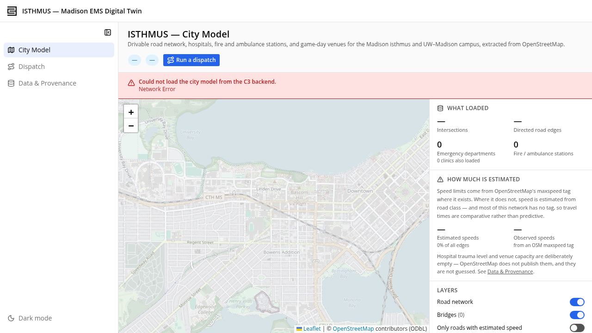

# ISTHMUS

**A digital twin of Madison for emergency-response simulation.**

**2nd Place, C3 AI Accelerator Hackathon** · C3 Code · Python · JavaScript · Routing Algorithms

ISTHMUS builds a digital copy of Madison, Wisconsin, to simulate extraordinary events and identify transportation bottlenecks and emergency-response vulnerabilities. It models how road closures, flooding, and crowd congestion change ambulance access across the city.

The project won **2nd Place at the C3 AI Accelerator Hackathon**. Its interactive C3 Code application integrates custom routing algorithms to dynamically reroute ambulances around blocked roads and explore emergency accessibility during infrastructure disruptions.



## What it does

- **Explore a city digital twin:** view Madison's road network, hospitals, EMS stations, venues, and extruded building footprints in an interactive 3D map.
- **Simulate disruptions:** compare normal conditions with a post-game surge and John Nolen Drive flood scenario using road closures, speed reductions, and congestion zones.
- **Reroute emergency response:** select an incident location and calculate the responding station, route to the scene, and transport route to an emergency department. Changing conditions recalculates the open incident.
- **Find vulnerable locations:** compare scenario travel times against baseline conditions across the modeled intersections.
- **Follow the response:** animate ambulance travel with a ride-along camera and inspect response and transport times.

## How routing works

Python scripts transform OpenStreetMap XML into a directed road graph and facility records. Each road segment carries its geometry, length, speed, direction, and data provenance.

The JavaScript `EmsRouter` service applies scenario overlays to the graph, removes closed edges, and adjusts travel costs for congestion. Two independent Dijkstra searches solve the journey: a reverse search identifies the responding station, and a forward search identifies the destination emergency department. Modeling the two legs separately respects Madison's one-way streets.

## Technology

| Layer | Tools |
| --- | --- |
| Application platform | C3 Code / C3 AI, C3 type definitions and data model |
| Data processing | Python, OpenStreetMap XML, JSON |
| Routing | JavaScript, directed graphs, Dijkstra's algorithm, scenario overlays |
| Interface | React, TypeScript, Vite, MapLibre GL, Tailwind CSS |

## Repository layout

```text
isthmus-etl/                  Python extraction scripts, cached OSM tiles, reports
pkg323033d0/
  data/                       Network, facilities, buildings, and scenario records
  src/                        C3 types and EmsRouter.js
  ui/react/                   React application and 3D map
isthmus-city-model.png        Project screenshot
```

## Running the project

The full application requires access to a C3 environment with the package types and data deployed. The frontend does not include an offline mock backend.

### Frontend development

Use Node.js 20.18+ and npm 10+.

```sh
cd pkg323033d0/ui/react
npm ci
```

Create a local `.env.local` file using values for your C3 environment:

```dotenv
VITE_C3_BASE_URL=https://your-c3-cluster.example
VITE_C3_ENV=your_environment
VITE_C3_APP=your_application
VITE_C3_PKG=pkg323033d0
VITE_C3_AUTH_TOKEN=your_local_development_token
```

Keep authentication tokens out of version control. Then start the development server:

```sh
npm run dev
```

The default development port is `9000`; the configured UI base path is `/<environment>/<application>/uiservice/`. The Vite proxy forwards backend requests to the configured C3 application.

Available checks and build commands:

```sh
npm run lint
npm test
npm run build
```

The build writes to `pkg323033d0/ui/content/pkg323033d0/`. Production builds require the authentication token to be unset or empty.

### Rebuilding the geographic data

The cached OpenStreetMap tiles are included under `isthmus-etl/raw/`. To regenerate the graph and building records from those tiles:

```sh
python3 isthmus-etl/build_graph.py
python3 isthmus-etl/build_buildings.py
```

These scripts rewrite generated data files and reports. `download_osm.py` can refresh the source tiles and requires network access.

## Modeling assumptions

Travel times are comparative simulation outputs. Some road speeds and most building heights are estimated, with provenance recorded in the data. Buildings provide visual context; routing uses the road graph. The model does not incorporate live dispatch, traffic, or hospital capacity feeds.

## Project origin and attribution

This repository preserves the original project history from [arymaheshwari/emergencyMadison](https://github.com/arymaheshwari/emergencyMadison), including the application developed on its workspace branch.

Geographic data is © [OpenStreetMap contributors](https://www.openstreetmap.org/copyright), available under the Open Database License. Existing C3 AI copyright and proprietary notices are retained in the source files; this repository does not add a new software license.
